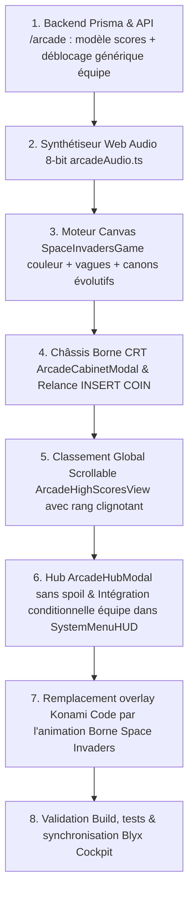

# 👾 Plan d'Implémentation Validé : Salle d'Arcade & Mini-Jeu "Space Invaders" Couleur

> **Date** : 17 octobre 2026 (Version mise à jour avec vos remarques sur la confidentialité et la généricité)  
> **Statut** : 🟡 Plan affiné — Prêt pour votre feu vert de démarrage  
> **Portée** : Monorepo `sosplanete-v2` (`evoe-frontend`, `backend-v2`, `admin-sosplanete-v2`, `.docs`)

---

## 🎯 Synthèse des Arbitrages & Vos Réponses Intégrées

| Point Clé | Arbitrage Confirmé | Détail de Réalisation |
|---|---|---|
| **Liaison Easter Egg / Énigmes** | **Architecture générique par énigme** | Le déblocage d'un mini-jeu peut être associé à **n'importe quelle énigme ou Easter Egg** du jeu. Pour Space Invaders, le choix naturel et le plus judicieux est le **Konami Code** (`EE_KONAMI_80S`). D'autres énigmes futures débloqueront d'autres mini-jeux. |
| **Confidentialité du Hub** | **Uniquement les jeux découverts (Zéro Spoil)** | **Aucun nom de futur jeu, aucun teaser, ni emplacement grisé n'apparaît** dans le menu ou la modale. Seuls les jeux effectivement découverts par un membre de l'équipe sont affichés (au départ, seul Space Invaders apparaîtra). |
| **Graphismes** | **Version Couleur Authentique (1979/1980)** | Couleurs Taito/Midway : calmars magenta/rose (30 pts), crabes cyan (20 pts), poulpes jaune/ambre (10 pts), canon et bunkers vert phosphore, soucoupe UFO rouge clignotante. |
| **Niveaux / Vagues** | **Oui, vagues successives comme l'original** | Enchaînement de vagues : les aliens démarrent un cran plus bas, cadence et vitesse accrues, accélération frénétique sur les derniers survivants. |
| **Armement du Canon** | **Canons plus puissants & évolutifs** | Canons améliorés (Tir standard ➔ Double laser ➔ Tir rapide) débloqués au franchissement de vagues ou en abattant la soucoupe mystère UFO. |
| **Vies & Durée** | **3 vies standard** | Canons en réserve affichés en bas à gauche de l'écran, parties nerveuses de 2 à 4 minutes. |
| **Bruitages sonores** | **100% Web Audio API 8-bit** | 4 notes descendantes qui s'accélèrent, son de laser percutant, explosion crunch 8-bit et sirène oscillante pour la soucoupe rouge. |
| **Classement High Scores** | **Classement global complet scrollable** | Défilement de l'ensemble des scores de l'école/instance. En fin de partie, le rang du joueur s'insère et clignote dans la liste à son emplacement exact. |
| **Relance Partie** | **Bouton rétro "INSERT COIN"** | Possibilité de rejouer immédiatement à volonté sans quitter la borne. |
| **Visibilité du Bouton** | **Strictement invisible au départ** | Aucun bouton "Mini-Jeux" dans le HUD tant qu'aucun Easter Egg lié à un mini-jeu n'a été découvert (secret préservé). |
| **Portée du Déblocage** | **Déblocage pour TOUTE L'ÉQUIPE** | Dès qu'un membre résout l'Easter Egg associé, le jeu et le bouton "Mini-Jeux" s'activent pour toute son équipe. |

---

## 🏗️ Architecture & Flux Applicatif

```mermaid
graph TD
    A[Résolution d'un Easter Egg / Énigme associé (ex: Konami Code pour Space Invaders)] -->|Validation Backend| B[Déblocage Équipe : gameKey]
    B --> C[Apparition Bouton 'Mini-Jeux' dans SystemMenuHUD pour toute l'équipe]
    C --> D[Salle d'Arcade Hub : ArcadeHubModal (Affiche UNIQUEMENT les jeux découverts)]
    D --> E[Borne Space Invaders Couleur : ArcadeCabinetModal]
    E --> F[Moteur Canvas 60 FPS + Vagues Successives]
    F --> G[Canons Évolutifs : Simple / Double / Rapide]
    F --> H[Bruitages Rétro Web Audio API Procéduraux]
    F --> I[Fin de Partie : Calcul du Score & Envoi API]
    I --> J[Tableau Global Scrollable des High Scores avec Rang Clignotant]
    J -->|Bouton INSERT COIN| F
```

---

## 🎮 Module 1 : Moteur de Jeu "Space Invaders" Couleur & Vagues Rétro

### 1.1. Rendu Couleur Rétro Authentique (Taito/Midway 1979-1980)
- [ ] **Palette d'époque appliquée au Canvas 60 FPS** :
  - **Rangée supérieure** (Calmars / 30 pts) : **Magenta / Rose vif**.
  - **Rangées médianes** (Crabes / 20 pts) : **Bleu Cyan**.
  - **Rangées inférieures** (Poulpes / 10 pts) : **Jaune Vif / Ambré**.
  - **Canon Défenseur & 4 Bunkers** : **Vert Phosphore néon**.
  - **Soucoupe Mystère (UFO)** : **Rouge Vif Clignotant** (100, 150 ou 300 pts bonus).
  - **Tirs du joueur** : Verts / **Tirs des aliens** : Blancs en zigzag.
- [ ] **Bunkers destructibles** : S'effritent pixel par pixel sous les tirs alliés et ennemis.
- [ ] **Animation 2-frames** de marche synchronisée sur le tempo sonore.

### 1.2. Niveaux & Vagues Successives (Comme à l'époque)
- [ ] **Vague 1** : Les 55 aliens démarrent à mi-hauteur d'écran, vitesse de croisière nominale.
- [ ] **Vagues 2, 3, etc.** : À chaque fois qu'un tableau est nettoyé (*"WAVE CLEARED"*), les envahisseurs réapparaissent **un cran plus bas**, descendent plus rapidement et augmentent leur cadence de tirs.
- [ ] **Accélération exponentielle** : Plus les aliens sont détruits, plus les survivants accélèrent. Le dernier alien traverse l'écran à toute vitesse.
- [ ] **Condition de défaite instantanée** : Si un alien atteint la ligne basse des bunkers, la Terre est envahie ➔ *GAME OVER* immédiat quelle que soit la réserve de vies.

### 1.3. Canons Défenseurs Évolutifs & Power-Ups
- [ ] **Canon Initial (Niveau 1)** : Tir laser simple standard (1 projectile à l'écran).
- [ ] **Double Canon Laser** : Deux lasers parallèles tirés simultanément (couvre une zone plus large). Débloqué en abattant la Soucoupe Rouge UFO ou au passage à la Vague 2.
- [ ] **Canon Laser Rapide (Cadence Améliorée)** : Permet d'enchaîner 2 à 3 tirs à l'écran sans attendre la sortie du tir précédent.
- [ ] **3 Vies Standard** : Décomptées en bas de l'écran avec l'icône des petits canons verts. Animation de destruction en croix blanche pixelisée lors d'un impact fatal.

### 1.4. Bruitages 8-Bit Procéduraux (Web Audio API)
- [ ] **4 notes de marche descendantes** en boucle dont le tempo accélère avec l'élimination des aliens.
- [ ] **Tir laser percutant** sur chaque tir du canon.
- [ ] **Explosion crunch 8-bit** lors de la destruction d'un alien, bunker ou du canon joueur.
- [ ] **Sirène modulée en onde sinusoïdale** lorsque la Soucoupe Rouge traverse le haut de l'écran.
- [ ] *Zéro téléchargement de fichier audio lourd* : sons générés en temps réel via des oscillateurs Web Audio.

### 1.5. Contrôles Hybrides PC & Mobile
- [ ] **PC (Clavier)** : Flèches directionnelles `◄` `►` ou touches `Q`/`D` (`A`/`D`) + `Barre Espace` pour faire feu.
- [ ] **Mobile / Tablette** : Manette tactile virtuelle rétro semi-transparente en bas de l'écran avec boutons directionnels et bouton rouge proéminent `[ FIRE ]`.

---

## 🏆 Module 2 : Classement Global Scrollable & Fin de Partie "Hall of Fame"

### 2.1. Tableau des Scores Complet & Scrollable
- [ ] **Affichage global de tous les scores de l'école/instance** :
  ```text
  ╔═════════════════════════════════════════════════════════════════════════╗
  ║                    SPACE INVADERS — ALL-TIME RANKING                    ║
  ╠══════╦══════════════╦══════════════╦═══════════════╦══════════╦═════════╣
  ║ RANK ║    SCORE     ║    AGENT     ║    ÉQUIPE     ║  VAGUE   ║  DATE   ║
  ╠══════╬══════════════╬══════════════╬═══════════════╬══════════╬═════════╣
  ║  1ST ║    15 420    ║ NICOLAS      ║ TERRE         ║ WAVE 4   ║ 17/10   ║
  ║  2ND ║    12 850    ║ ALEXANDRE    ║ EAU           ║ WAVE 3   ║ 16/10   ║
  ║  3RD ║     9 400    ║ CYBER_LÉO    ║ FEU           ║ WAVE 3   ║ 15/10   ║
  ║  ... ║      ...     ║ ...          ║ ...           ║ ...      ║ ...     ║
  ║ 17TH ║     3 850    ║ VOUS (AGENT) ║ AIR           ║ WAVE 2   ║ 17/10   ║
  ║  ... ║      ...     ║ ...          ║ ...           ║ ...      ║ ...     ║
  ╚══════╩══════════════╩══════════════╩═══════════════╩══════════╩═════════╝
  ```
- [ ] **Défilement fluide rétro** : Barre de scroll stylisée arcade permettant de parcourir l'ensemble des scores enregistrés.
- [ ] **Insertion dynamique & Clignotement du rang** :
  - Dès le `GAME OVER`, le score est enregistré via l'API.
  - La vue bascule automatiquement sur le classement complet, scrollée directement à la hauteur de la ligne du joueur.
  - La ligne du joueur **clignote en vert néon** avec mention *"VOTRE SCORE : 3 850 PTS — RANG #17"* comme sur les bornes des bars d'époque.

### 2.2. Relance Immédiate "INSERT COIN"
- [ ] Grand bouton arcade rétro clignotant **`[ 🪙 INSERT COIN / REJOUER ]`** sous le tableau des scores pour relancer immédiatement une nouvelle partie sans recharger la page.

---

## 🕹️ Module 3 : Hub "Salle d'Arcade" & Confidentialité Totale

### 3.1. Règle de Visibilité Stricte dans le Menu
- [ ] Dans [SystemMenuHUD.tsx](file:///c:/Users/User/Documents/Sync%20Pcloud/Professionnel/Dev/sosplanete-v2/apps/evoe-frontend/src/components/ui/SystemMenuHUD.tsx) :
  - **Avant découverte** : Le bouton `Mini-Jeux` est **totalement absent** du menu (aucune mention, aucun indice).
  - **Après découverte d'un premier mini-jeu** : Le bouton `Mini-Jeux` (icône `Gamepad2`) apparaît avec un badge lumineux *"NOUVEAU"* pour **l'ensemble des membres de l'équipe** du joueur qui a trouvé l'Easter Egg.

### 3.2. Salle d'Arcade : Zéro Spoil & Affichage Strict des Jeux Découverts
- [ ] Modale `ArcadeHubModal.tsx` :
  - **Règle absolue** : **Aucun nom de futur jeu, aucun emplacement grisé, aucun texte prévisionnel n'est affiché.**
  - La modale liste **exclusivement** les jeux que l'équipe a débloqués.
  - Au départ, seul **Space Invaders** s'affiche dans la salle d'arcade.
  - Si plus tard un membre de l'équipe découvre une autre énigme associée à un autre mini-jeu, ce nouveau jeu s'ajoutera naturellement à la liste de l'équipe.

---

## 💾 Module 4 : Backend & Architecture Générique des Déblocages

### 4.1. Modèle Prisma & Association Énigmes / Mini-Jeux
- [ ] **Table `ArcadeScore`** :
  - `id` (Int, clé primaire)
  - `gameKey` (String, ex: `'space-invaders'`)
  - `childId` (Int, joueur)
  - `childPseudo` (String)
  - `teamId` (Int, équipe du joueur)
  - `teamName` (String, ex: 'TERRE', 'EAU')
  - `instanceYearId` (Int, périmètre école/instance)
  - `score` (Int)
  - `waveReached` (Int, vague atteinte)
  - `createdAt` (DateTime)
  - *Index composite : `[gameKey, instanceYearId, score(Desc)]` pour un tri instantané.*
- [ ] **Table `TeamUnlockedArcadeGame`** :
  - `teamId` (Int)
  - `gameKey` (String, ex: `'space-invaders'`)
  - `easterEggCode` (String, ex: `'EE_KONAMI_80S'`) : Permet d'associer n'importe quel Easter Egg ou énigme au jeu correspondant.
  - `unlockedAt` (DateTime)
  - `discoveredByChildId` (Int)
  - Assure que le déblocage est effectif pour tous les membres de la même équipe.

### 4.2. API NestJS (`apps/backend-v2/src/modules/arcade/`)
- [ ] `GET /arcade/unlocked` : Renvoie la liste des mini-jeux débloqués pour l'équipe du joueur connecté (ex: `['space-invaders']`).
- [ ] `GET /arcade/scores/:gameKey` : Renvoie le classement global complet trié par score décroissant pour l'instance.
- [ ] `POST /arcade/scores/:gameKey` : Enregistre le score et renvoie le rang exact obtenu pour centrer le classement.

---

## 🚦 Feuille de Route d'Implémentation (Dès votre accord)



---

> 🔒 **Statut Actuel** : Aucun code n'a encore été produit.  
> 💬 **Dès que vous confirmez : "lance le plan" ou "ok pour le code", je lancerai immédiatement les développements en commençant par le backend et le moteur de jeu.**
