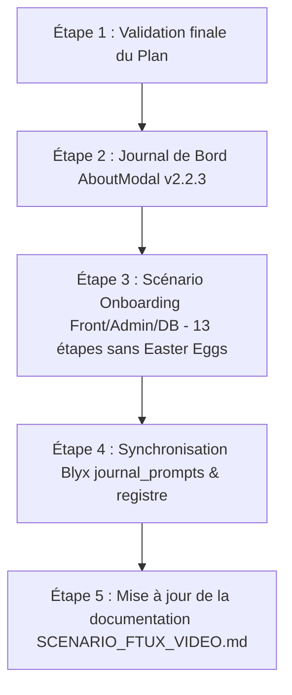

# 📋 Plan d'Action : Mise à Jour du Journal de Bord, de l'Onboarding et du Cockpit Blyx

> **Date de rédaction** : 17 octobre 2026  
> **Statut** : 🟢 Exécuté & Déployé avec succès (Builds validés)  
> **Portée** : Monorepo `sosplanete-v2` (`apps/evoe-frontend`, `apps/admin-sosplanete-v2`, `apps/backend-v2`, `.docs`)

---

## 🎯 Objectifs

Remettre en cohérence l'ensemble des éléments d'information utilisateur et de gouvernance du projet :
1. **Journal de bord in-app** (`AboutModal`) : refléter les versions réelles (v2.0.0 à v2.2.3), corriger la date d'expiration pour maintenir l'affichage actif et intégrer les fonctionnalités majeures livrées. *(Validé)*
2. **Onboarding FTUX** (`OnboardingGuide`, Admin, Base de données et documentation) : moderniser les étapes avec la Recherche d'Agents 3D, **sans dévoiler l'existence des Easter Eggs ni des énigmes qui doivent rester strictement secrets**, et aligner la source de vérité.
3. **Pilotage Blyx** (`journal_prompts.json`, `registre_avancement.md`) : réintégrer l'historique des travaux réalisés entre le 3 septembre et le 17 septembre 2026 (séries US 13.x, 14.x, 15.x).

---

## 📑 Sommaire des Chantiers

- [Chantier 1 : Journal de Bord In-App (AboutModal) — VALIDÉ](#chantier-1--journal-de-bord-in-app-aboutmodal--validé)
- [Chantier 2 : Onboarding Interactif & Parcours FTUX — AJUSTÉ](#chantier-2--onboarding-interactif--parcours-ftux--ajusté)
- [Chantier 3 : Pilotage Blyx Cockpit & Traçabilité](#chantier-3--pilotage-blyx-cockpit--traçabilité)
- [Déroulement et Ordre d'Exécution Validé](#déroulement-et-ordre-dexécution-validé)

---

## 🛠️ Chantier 1 : Journal de Bord In-App (AboutModal) — VALIDÉ

### Diagnostic Actuel
* La modale [AboutModal.tsx](file:///c:/Users/User/Documents/Sync%20Pcloud/Professionnel/Dev/sosplanete-v2/apps/evoe-frontend/src/components/ui/AboutModal.tsx) est bloquée sur la version **1.6.3** datée du **13/09/2026**.
* Dans [App.tsx](file:///c:/Users/User/Documents/Sync%20Pcloud/Professionnel/Dev/sosplanete-v2/apps/evoe-frontend/src/App.tsx#L3210), `releaseDate="2026-09-13T00:00:00.000Z"` entraîne l'expiration de la section *"Dernières Évolutions"* (timeout dépassé).
* Les évolutions v2.0.0, v2.1.0/v2.2.0 et v2.2.3 doivent être réintégrées.

### Actions Planifiées (Validées par l'utilisateur)

- [ ] **1.1. Synchronisation dynamique de la version et pérennité de l'affichage** :
  - Lier la version affichée à celle du `package.json` (`v2.2.3`).
  - Ajuster `releaseDate` / logique de péremption pour que la section des évolutions reste affichée en permanence tant qu'une version supérieure n'est pas déployée.
- [ ] **1.2. Rédaction des cartes d'évolutions récentes (v2.0 à v2.2.3)** :
  - **Module Télémétrie & Traçabilité (v2.0.0)** : Audit en temps réel des actions des joueurs, timeline de session sécurisée et cockpit de modération.
  - **Secrets Temporels & Interactions Spéciales (v2.1.0)** : Mécaniques de découvertes interactives, animations et ambiance sonore cryptex.
  - **Mascotte 3D & Recherche Holographique (v2.2.0)** : Présence de la mascotte d'équipage, rotation cinématique d'inspection d'un agent et anneau holographique au sol.
  - **Broadcast Période & Stabilité Graphique (v2.2.3)** : Notification automatique de début de cycle sur le chat d'équipage, jauge de santé optimisée et affichage épuré sur mobile.
- [ ] **1.3. Actualisation du catalogue des Épics (EPICS_DATA)** :
  - `EPIC-11 : Télémétrie, Audit & Traçabilité des Sessions`.
  - `EPIC-12 : Secrets Temporels, Mascotte & Énigmes Interactives`.

---

## 🚀 Chantier 2 : Onboarding Interactif & Parcours FTUX — AJUSTÉ

### Arbitrage Utilisateur Pris en Compte
> ⚠️ **Directive stricte** : Il ne faut absolument pas que l'utilisateur puisse deviner qu'il y a des Easter Eggs et des énigmes. Aucune mention d'œufs cachés, d'énigmes ou de secrets ne doit figurer dans le guide d'onboarding.

### Proposition de Scénario Retenue (13 étapes ou 12 étapes compactes)

#### Option A (Recommandée — 13 étapes fluides) :
1. **Étape 1 / 13** : 🚀 **Identité de l'Agent & Bio-stabilité** (`hud-agent-profile`)  
   *Votre identité d'explorateur, équipage et jauge de bio-stabilité.*
2. **Étape 2 / 13** : 🌍 **La Passerelle 2026 & Secteurs Écologiques** (`sector-orb-guide`)  
   *La Terre en 2026 et ses orbes cristallines de secteurs écologiques (Eau, Énergie, Biodiversité, Déchets...).*
3. **Étape 3 / 13** : ⚡ **Le Codex & Impulsion d'une Mission** (`hud-active-mission-card`)  
   *Catalogue d'actions éco-responsables à réaliser dans la vraie vie et bouton d'impulsion.*
4. **Étape 4 / 13** : ⚡ **La Puissance des Impulsions Temporelles (IT)** (`mission-card-it-counter`)  
   *Comprendre l'énergie vitale IT envoyée vers le futur pour régénérer la planète.*
5. **Étape 5 / 13** : 🔍 **Recherche d'Agents & Cartographie 3D** (`hud-search-button` / `PlayerSearchHUD`) *(NOUVEAU)*  
   *Localisez instantanément vos coéquipiers dans la scène 3D avec centrage gyroscopique et anneau holographique au sol.*
6. **Étape 6 / 13** : 🌕 **L'Arène des Défis Temporels** (`hud-moon-arena`)  
   *Défier les équipes adverses via la Lune en orbite ou le profil d'un joueur avec chrono et gage.*
7. **Étape 7 / 13** : 📊 **Terre 2070 : % Régénérée** (`hud-completion-bar`)  
   *Jauge de guérison planétaire collective évoluant en direct avec les éco-gestes de l'équipage.*
8. **Étape 8 / 13** : ⏳ **Commutateur Temporel : Cap sur 2070** (`hud-epoch-switch`)  
   *Voyager à tout moment vers 2070 pour constater l'impact à long terme des actions actuelles.*
9. **Étape 9 / 13** : 🔮 **Extrapolation 2070 & Bilan d'Impact** (`panel-extrapolation-2070`)  
   *Indicateurs écologiques mondiaux : recul du dépassement, glace préservée, équivalences concrètes.*
10. **Étape 10 / 13** : 🚀 **Radar Temporel & Niveaux de Propulsion** (`panel-radar-2070`)  
    *Les 5 paliers technologiques d'évolution des vaisseaux selon la régénération planétaire.*
11. **Étape 11 / 13** : 🏆 **Podium 3D & Progression** (`btn-podium-leaderboard`)  
    *Classement holographique 3D des vaisseaux et consultation des fiches d'agents.*
12. **Étape 12 / 13** : 💬 **Com-Link & Messagerie d'Équipage** (`chat-panel-container`)  
    *Canal de communication en direct pour coordonner les actions et annonces de période.*
13. **Étape 13 / 13** : ⚙️ **Menu Système, WhatsApp & Paramètres** (`hud-system-menu`)  
    *Bulle d'options unifiée pour rejoindre WhatsApp d'équipe, relancer ce guide, ajuster la qualité 3D ou voir le journal de bord.*

*(Variante B : Possibilité de fusionner les étapes 3 et 4 en une seule pour conserver exactement 12 étapes au total si souhaité).*

### Actions Planifiées

- [ ] **2.1. Mise à jour de [OnboardingGuide.tsx](file:///c:/Users/User/Documents/Sync%20Pcloud/Professionnel/Dev/sosplanete-v2/apps/evoe-frontend/src/components/ui/OnboardingGuide.tsx)** :
  - Intégrer l'étape Recherche 3D (`hud-search-button`).
  - Veiller à ce qu'aucun texte ne fasse référence aux Easter Eggs ni aux énigmes.
- [ ] **2.2. Alignement Frontend, Administration et Base de données** :
  - Reporter exactement les mêmes étapes dans [FTUXSettings.tsx](file:///c:/Users/User/Documents/Sync%20Pcloud/Professionnel/Dev/sosplanete-v2/apps/admin-sosplanete-v2/src/components/settings/FTUXSettings.tsx).
  - Aligner l'étape 13 (ou 12) sur `hud-system-menu` dans `FTUXSettings.tsx` et [update-steps.js](file:///c:/Users/User/Documents/Sync%20Pcloud/Professionnel/Dev/sosplanete-v2/apps/backend-v2/update-steps.js).
  - Mettre à jour `SystemConfig.ftuxSteps` en base pour éviter toute réinjection des anciennes étapes par l'API.
- [ ] **2.3. Réécriture de la documentation fonctionnelle** :
  - Actualiser [SCENARIO_FTUX_VIDEO.md](file:///c:/Users/User/Documents/Sync%20Pcloud/Professionnel/Dev/sosplanete-v2/.docs/SCENARIO_FTUX_VIDEO.md) avec le parcours propre à 13 étapes.
  - Rectifier le libellé de l'US 2.2 dans [registre_avancement.md](file:///c:/Users/User/Documents/Sync%20Pcloud/Professionnel/Dev/sosplanete-v2/.docs/blyx_cockpit/registre_avancement.md).

---

## 📊 Chantier 3 : Pilotage Blyx Cockpit & Traçabilité

### Diagnostic Actuel
* Le journal [.docs/blyx_cockpit/journal_prompts.json](file:///c:/Users/User/Documents/Sync%20Pcloud/Professionnel/Dev/sosplanete-v2/.docs/blyx_cockpit/journal_prompts.json) s'arrête au 02/09/2026.
* Les travaux v2.0.0 à v2.2.3 livrés entre le 03/09 et le 17/09 doivent être réintégrés dans la gouvernance Blyx.

### Actions Planifiées
- [ ] **3.1. Rétrospective des US v2.0 à v2.2** :
  - `US 13.1` : Télémétrie temps réel & Suivi des sessions joueurs.
  - `US 13.2` : Cockpit d'audit, timeline de navigation et purges sécurisées.
  - `US 14.1` : Architecture & Détection des Easter Eggs / Mystères temporels (côté dev/admin).
  - `US 14.2` : Composants interactifs Mascotte 3D, Cryptex audio/vidéo & Énigmes.
  - `US 15.1` : Passerelle WebSocket & Broadcast automatique des messages de début de cycle.
  - `US 15.2` : Optimisations Three.js 60 FPS, occlusion de profondeur & ergonomie mobile.
- [ ] **3.2. Synchronisation Blyx idempotente** :
  - Générer les hashes SHA-256 avec date d'origine pour chaque intervention de septembre.
  - Injecter les entrées dans `journal_prompts.json`.
- [ ] **3.3. Mise à jour des indicateurs et registre d'avancement** :
  - Consolider [registre_avancement.md](file:///c:/Users/User/Documents/Sync%20Pcloud/Professionnel/Dev/sosplanete-v2/.docs/blyx_cockpit/registre_avancement.md) (consommé, VA, RAF).
  - Aligner `liste_id_stories.md` et `backlog_roadmap.md`.

---

## 🚦 Déroulement et Ordre d'Exécution Validé

