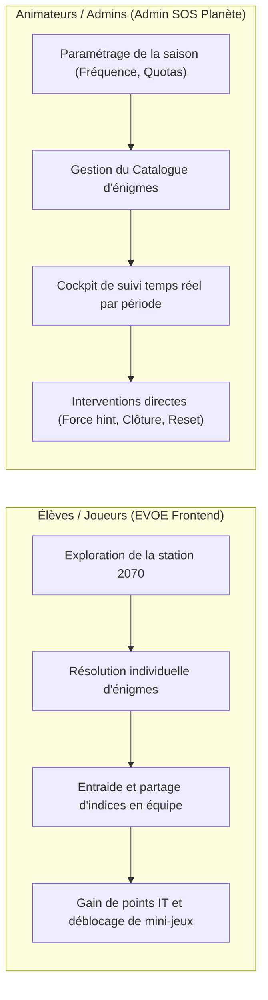
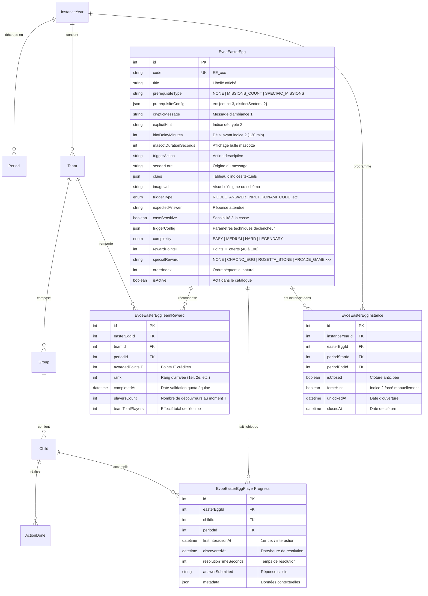
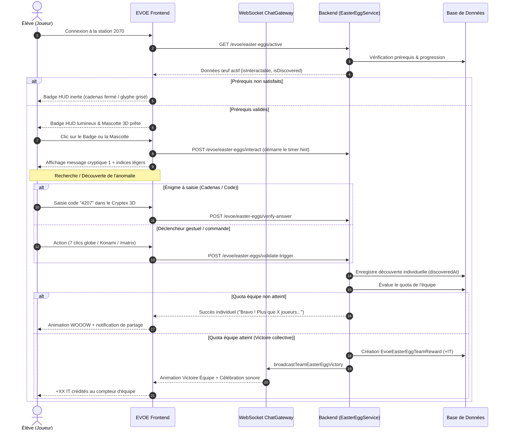

# Plan d'Arbitrage & Rétro-Spécification — Système des Easter Eggs (EVOE / SOS Planète)

> **Document de cadrage & d'arbitrage** : Ce document sert à la fois de rétro-spécification complète de l'existant et de **cahier d'annotations interactif**.  
> **Mode d'emploi** : Cochez les cases (`[x]`), commentez ou complétez directement les blocs `> ✍️ **Annotation / Votre besoin :**` pour exprimer vos attentes avant toute implémentation.  
> **Cible** : `.docs/3-fct/retro-specification-easter-eggs.md`  
> **Périmètre applicatif** : `backend-v2`, `evoe-frontend`, `admin-sosplanete-v2`  
> **Date de mise à jour** : Novembre 2026

---

## 🧭 Tableau de Bord d'Arbitrage Rapide

*Utilisez ce tableau pour indiquer vos décisions macro en cochant simplement les options souhaitées :*

| Domaine Fonctionnel | Règle Actuelle du Code | Conserver | À Modifier | À Supprimer | Décision Validée |
|---|---|:---:|:---:|:---:|---|
| **1. Quota d'Équipe** | Nominal par difficulté (Easy=5, Med=3, Hard=2) écrase le paramètre admin | [x] | [ ] | [ ] | **Option B** : Conserver le barème par difficulté et retirer le champ admin |
| **2. Synchronisation** | "Team Rollover" : l'équipe en retard reste sur l'ancien œuf | [ ] | [x] | [ ] | **Option D** : Multi-œufs cumulatifs chronologiques (plus ancien en 1er) |
| **3. Fréquence** | 1 œuf toutes les 2 périodes (cycle de 2 semaines) | [x] | [ ] | [ ] | **Option B** : 1 œuf par cycle de 2 semaines, prérequis cumulés sur le cycle |
| **4. Cycles neutres** | Cycles 4, 8, 14, 19 codés en dur comme "sans énigmes" | [ ] | [x] | [ ] | **Option B** : Pauses par défaut dynamiques f(T) + ajout possible d'œufs par l'admin |
| **5. Prérequis** | 3 actions dans 2 secteurs distincts dans le cycle | [x] | [ ] | [ ] | **Catalogue** : Définis unitairement sur chaque œuf du catalogue (calculés sur le cycle) |
| **6. Indice 2 (Timer)** | Révélé après 120 min (2h) à compter du 1er clic | [x] | [ ] | [ ] | **Catalogue (2h par défaut)** : Défini sur chaque œuf du catalogue (120 min par défaut) |
| **7. Forçage Indice** | Bouton Admin force l'indice pour toute la promotion d'un coup | [ ] | [x] | [ ] | **Bouton Unique Popup** : Toutes par défaut OU équipe ciblée + option d'annulation |
| **8. Mini-jeux Arcade** | Débloqué pour l'équipe entière dès la 1ère découverte | [x] | [ ] | [ ] | **Conserver** : Déblocage collectif au 1er joueur |
| **9. Rattrapage (Chrono-Egg)**| Rejeu des archives passées réservé aux détenteurs de l'artefact | [x] | [ ] | [ ] | **Conserver** : Rejeu réservé aux détenteurs de l'outil |
| **10. Méta-Énigme** | Reconstitution d'un mot secret de 7 lettres avec 12 glyphes | [x] | [ ] | [ ] | **Conserver** : Pierre de Rosette et mot secret |

---

## Sommaire Détaillé

1. [Vision Globale & Objectifs Métier](#1-vision-globale--objectifs-métier)
2. [Architecture des Données (Modèles Prisma & PostgreSQL)](#2-architecture-des-données-modèles-prisma--postgresql)
3. [Catalogue des Énigmes (22 Easter Eggs Recensés)](#3-catalogue-des-énigmes-22-easter-eggs-recensés)
4. [Expérience Joueur & Déclencheurs (Frontend EVOE)](#4-expérience-joueur--déclencheurs-frontend-evoe)
5. [Moteur de Résolution, Quotas & Récompenses (Backend)](#5-moteur-de-résolution-quotas--récompenses-backend)
6. [Planification Temporelle, Cycles & Système de Report (Rollover)](#6-planification-temporelle-cycles--système-de-report-rollover)
7. [Méta-Énigme Saisonnière & Artefacts Temporels](#7-méta-énigme-saisonnière--artefacts-temporels)
8. [Pilotage Back-Office (Admin SOS Planète)](#8-pilotage-back-office-admin-sos-planète)
9. [Matrice des Endpoints API & Événements WebSocket](#9-matrice-des-endpoints-api--événements-websocket)
10. [Fiches d'Arbitrage Détaillées sur les Points de Friction](#10-fiches-darbitrage-détaillées-sur-les-points-de-friction)

---

## 1. Vision Globale & Objectifs Métier

Le système des **Easter Eggs** d'EVOE (SOS Planète) est un dispositif ludo-pédagogique immersif conçu pour stimuler l'exploration active de la plateforme par les enfants (agents 2070), susciter la coopération au sein de leur équipe, et récompenser la perspicacité collective.

### 1.1. Les deux publics cibles

### 1.2. Piliers d'expérience
1. **L'immersion narrative 2070** : Chaque œuf est scénarisé comme une anomalie temporelle, une transmission radio cryptée ou une relique des pionniers pré-spatiaux.
2. **Le verrouillage conditionnel (Prérequis)** : Un œuf n'est interactif que si le joueur a réalisé un certain engagement écologique dans la période courante (ex: 3 missions validées dans 2 secteurs distincts).
3. **Le double palier de découverte** :
   - *Palier individuel* : L'enfant trouve la solution ou active le mécanisme sur son écran (enregistrement du découvreur, chrono personnel, animations visuelles WOOOW).
   - *Palier d'équipe (Coopération stricte)* : L'équipe ne remporte les **points d'Impact Territorial (IT)** que lorsqu'un **quota minimum d'élèves de l'équipe** a également validé l'énigme.
4. **Le fil rouge méta-jeu (Chrono-Egg & Pierre de Rosette)** : La collecte de glyphes temporels sur les cycles de la saison permet d'alimenter un terminal de décryptage final menant à la révélation du "Protocole Oméga" (Vision 2050).

> ✍️ **Annotation / Arbitrage sur la Vision :**  
> - [ ] Conforme à ma vision  
> - [ ] À ajuster : *(notez ici les changements souhaités sur les objectifs ou la narration)*

---

## 2. Architecture des Données (Modèles Prisma & PostgreSQL)

Le système repose sur 4 tables principales et s'articule avec les entités de jeu existantes (`InstanceYear`, `Period`, `Team`, `Child`, `ActionDone`).

### 2.1. Champs de configuration dans `InstanceYear` & `GameConfig`
- `easterEggsEnabled` (boolean, défaut `true`) : Active ou désactive totalement le système sur l'espace.
- `easterEggFrequency` (int, défaut `2`) : Nombre de périodes durant lesquelles un œuf reste actif par défaut (ex: `2` = un nouvel œuf toutes les 2 périodes).
- `easterEggRequiredPlayers` (int, défaut `2`) : Quota standard de joueurs par équipe requis pour débloquer les points IT.
- `easterEggMaxWinningTeams` (int, défaut `0`) : Nombre maximal d'équipes pouvant être récompensées sur une énigme (`0` = illimité, toutes les équipes peuvent gagner).
- `metaEnigmaSecretWord` (string, défaut `"CHRONOS"`) : Mot secret final à reconstituer via les glyphes de périodes.
- `metaEnigmaPeriodGlyphs` (json) : Table de correspondance personnalisée périodes / glyphes.

> ✍️ **Annotation / Arbitrage sur les Données :**  
> - [ ] Modèle de données suffisant et validé  
> - [ ] Champs à ajouter / supprimer / modifier : *(précisez ici)*

---

## 3. Catalogue des Énigmes (22 Easter Eggs Recensés)

Le code source initialise par défaut un catalogue de **22 énigmes**. Vous pouvez annoter chacune d'elles ci-dessous :

| # | Code | Titre | Trigger Type | Réponse / Déclencheur | Difficulté | Points IT | Récompense Spéciale | Votre Décision |
|---|---|---|---|---|---|---|---|:---:|
| 1 | `EE_CADENAS_4CH_ARCHE` | Le Cadenas à 4 Chiffres de l'Arche | `RIDDLE_ANSWER_INPUT` | `4207` | MEDIUM | +60 IT | — | [ ] Garder [ ] Changer |
| 2 | `EE_KONAMI_80S` | Le Protocole des Anciens | `KONAMI_CODE` | `↑ ↑ ↓ ↓ ← → ← → B A` | EASY | +40 IT | `ARCADE_GAME:space-invaders` | [ ] Garder [ ] Changer |
| 3 | `EE_MATRIX_COMM_LINK` | La Matrice de l'Arche | `COMM_LINK_COMMAND` | `/matrix` ou `!matrix` | EASY | +40 IT | — | [ ] Garder [ ] Changer |
| 4 | `EE_OVERHEAT_EARTH_2026` | Le Réveil du Cœur 2026 | `CLICK_REPEATED` | 7 clics rapides sur le Globe 2026 | MEDIUM | +60 IT | — | [ ] Garder [ ] Changer |
| 5 | `EE_ANTIGRAVITY` | L’Apesanteur Artificielle | `COMM_LINK_COMMAND` | `/antigravity` ou `!antigravity` | MEDIUM | +60 IT | — | [ ] Garder [ ] Changer |
| 6 | `EE_FIVE_NOTES_PROFILE` | La Fréquence des 5 Échos | `METRIC_SEQUENCE` | Profil : Carbone ➔ Eau ➔ Déchets ➔ Carbone ➔ Eau | MEDIUM | +70 IT | — | [ ] Garder [ ] Changer |
| 7 | `EE_LOGO_ROCKET` | L’Impulsion du Grand Décollage | `LOGO_HOLD` | Maintien du logo EVOE pendant 3 secondes | MEDIUM | +60 IT | — | [ ] Garder [ ] Changer |
| 8 | `EE_CENTRAL_CONSOLE_2026` | Le Spectre de la Console Centrale | `CLICK_REPEATED` | 5 clics rapides sur la console Codex | MEDIUM | +60 IT | — | [ ] Garder [ ] Changer |
| 9 | `EE_TEMPORAL_1985` | Le Paradoxe Temporel 1985 | `COMM_LINK_COMMAND` / `TIMELINE_WARP` | `/1985` ou 5 bascules 2026/2070 en < 15s | HARD | +90 IT | — | [ ] Garder [ ] Changer |
| 10 | `EE_CONSTELLATION_3D` | Le Message de la Constellation | `SCREEN_EDGE` | Clic sur les 3 étoiles du triangle céleste | HARD | +100 IT | — | [ ] Garder [ ] Changer |
| 11 | `EE_PARTY_DISCO` | La Fête Orbitale | `COMM_LINK_COMMAND` | `!party` ou `/party` | EASY | +40 IT | — | [ ] Garder [ ] Changer |
| 12 | `EE_CHRONO_GENESIS` | Le Sceau du Chrono-Egg | `RIDDLE_ANSWER_INPUT` | `GENESIS` | HARD | +80 IT | `CHRONO_EGG` | [ ] Garder [ ] Changer |
| 13 | `EE_ROSETTA_DISCOVERY` | La Pierre de Rosette 2070 | `RIDDLE_ANSWER_INPUT` | `CHRONOS` | HARD | +80 IT | `ROSETTA_STONE` | [ ] Garder [ ] Changer |
| 14 | `EE_NEPTUNE_BEACON` | La Balise S.O.S de Neptune | `RIDDLE_ANSWER_INPUT` | `3014` | MEDIUM | +60 IT | — | [ ] Garder [ ] Changer |
| 15 | `EE_SPACESHIPS_FLEET` | L'Escadrille de l'Arche | `CUSTOM_ACTION` | Clic vaisseaux : Éclaireur ➔ Frégate ➔ Cargo | MEDIUM | +70 IT | — | [ ] Garder [ ] Changer |
| 16 | `EE_SOLAR_ECLIPSE` | L'Éclipse Solaire Artificielle | `COMM_LINK_COMMAND` | `!eclipse` | EASY | +50 IT | — | [ ] Garder [ ] Changer |
| 17 | `EE_TELLURIC_HARMONY` | L'Harmonie Tellurique | `METRIC_SEQUENCE` | Profil : Eau ➔ Déchets ➔ Eau ➔ Carbone ➔ Déchets | MEDIUM | +70 IT | — | [ ] Garder [ ] Changer |
| 18 | `EE_PULSAR_SIGNAL` | Le Signal Pulsar 2070 | `RIDDLE_ANSWER_INPUT` | `AURORA` | MEDIUM | +60 IT | — | [ ] Garder [ ] Changer |
| 19 | `EE_GRAVITON_LOCK` | Le Verrou de Graviton | `CUSTOM_ACTION` | 3 secousses physiques du smartphone (shake) | EASY | +50 IT | — | [ ] Garder [ ] Changer |
| 20 | `EE_OXYGEN_SPECTRUM` | Le Spectre de l'Oxygène Pur | `RIDDLE_ANSWER_INPUT` | `2070` | EASY | +50 IT | — | [ ] Garder [ ] Changer |
| 21 | `EE_WHALE_SONG` | Le Chant Bio-Acoustique | `COMM_LINK_COMMAND` | `!biosphere` | EASY | +50 IT | — | [ ] Garder [ ] Changer |
| 22 | `EE_QUANTUM_KEY` | La Clé Quantique Temporelle | `RIDDLE_ANSWER_INPUT` | `7331` (Miroir Leet) | HARD | +80 IT | — | [ ] Garder [ ] Changer |

> ✍️ **Annotation / Arbitrage sur le Catalogue :**  
> - [ ] Catalogue global satisfaisant  
> - [ ] Énigmes à supprimer ou nouvelles énigmes à créer : *(précisez ici)*

---

## 4. Expérience Joueur & Déclencheurs (Frontend EVOE)

### 4.1. Le parcours utilisateur type

### 4.2. Les 9 types de déclencheurs techniques
1. `RIDDLE_ANSWER_INPUT` : Pavé de saisie numérique ou textuelle (ex: Cryptex 4 chiffres ou champ de commande terminal).
2. `KONAMI_CODE` : Séquence `↑ ↑ ↓ ↓ ← → ← → B A`. Supporté sur clavier PC, swipes directionnels tactiles sur mobile, ou boutons virtuels B/A. Une alternative textuelle `konami` ou `arcade` dans le Comm-Link est également acceptée.
3. `COMM_LINK_COMMAND` : Saisie d'une commande dans le chat Comm-Link commençant par `/` ou `!` (ex: `/matrix`, `/antigravity`, `!party`).
4. `CLICK_REPEATED` : Clics multiples et consécutifs dans un intervalle de 2,5 secondes sur un élément précis du DOM ou de la scène 3D (`globe2026`, `codexConsole`).
5. `LOGO_HOLD` : Maintien continu de l'appui sur le logo EVOE (durée paramétrée, par défaut 3 secondes).
6. `METRIC_SEQUENCE` : Clic ordonné sur les jauges du profil agent (ex: Carbone ➔ Eau ➔ Déchets).
7. `SCREEN_EDGE` / `CONSTELLATION` : Clics sur des points précis de l'écran ou de l'espace céleste 3D (triangle stellaire).
8. `TIMELINE_WARP` : Bascule effrénée entre les époques 2026 et 2070 (au moins 5 fois en moins de 15 secondes).
9. `CUSTOM_ACTION` : Événements matériels ou gestes personnalisés (ex: secousse physique `device_shake` via gyroscope mobile).

### 4.3. Gestion des indices à deux niveaux
- **Niveau 1 : Message Cryptique & Clues** : Accessible immédiatement dès que l'œuf est déverrouillé par les prérequis.
- **Niveau 2 : Indice Explicite (`explicitHint`)** :
  - Déclenché automatiquement après un délai d'attente (`hintDelayMinutes`, par défaut **120 minutes = 2 heures**) calculé à partir de la première interaction (`firstInteractionAt`).
  - Ou débloqué instantanément pour tous les joueurs si l'Animateur clique sur "Forcer l'indice" depuis le Cockpit Admin.

> ✍️ **Annotation / Arbitrage sur l'Expérience Joueur :**  
> - [ ] Prérequis : Conserver 3 missions dans 2 secteurs  
> - [ ] Prérequis : Modifier la règle : *(ex: 1 seule mission, aucune mission, etc.)*  
> - [ ] Délai d'indice 2 : Conserver 120 min  
> - [ ] Délai d'indice 2 : Modifier la durée : *(ex: 30 min, 24h, immédiat, etc.)*  
> - [ ] Déclencheurs : Remarques ou souhaits particuliers : *(notez ici)*

---

## 5. Moteur de Résolution, Quotas & Récompenses (Backend)

### 5.1. Calcul des prérequis individuels (`checkPrerequisites`)
Le moteur backend évalue si l'élève est éligible pour interagir avec l'œuf. Trois modes existent :
- `NONE` : Aucune condition requise.
- `MISSIONS_COUNT` (par défaut) : L'enfant doit avoir validé au moins `count` missions (défaut : **3 missions**) réparties sur au moins `distinctSectors` catégories/secteurs distincts (défaut : **2 secteurs**) au cours des périodes du cycle en cours.
- `SPECIFIC_MISSIONS` : L'enfant doit avoir accompli des missions spécifiques désignées par leur code ou leur identifiant (`missionCodes`, `missionIds`), en mode `ALL` (toutes requises) ou `ANY` (au moins une).

> **Règle stricte de réversibilité** : Si un enfant annule une mission et que ses totaux passent sous le seuil requis, le statut `isInteractable` retombe immédiatement à `false` et son compteur d'indice est réinitialisé.

### 5.2. Quota de validation d'équipe (`getRequiredPlayersForEgg`)
Une équipe ne valide pas l'énigme dès la première découverte d'un de ses membres. Le nombre d'élèves requis est déterminé selon une logique à deux niveaux :

1. **Règle nominale par niveau de complexité de l'œuf** :
   - `EASY` : **5 joueurs** requis.
   - `MEDIUM` : **3 joueurs** requis.
   - `HARD` : **2 joueurs** requis.
   - `LEGENDARY` : **1 joueur** requis.
2. **Plafonnement à l'effectif réel** :
   - Si l'équipe compte moins de membres que le quota nominal (ex: une classe ou équipe de 2 élèves face à un œuf `EASY`), le quota est automatiquement plafonné à l'effectif total :  
     $$\text{Quota} = \min(\text{Nominal}, \text{EffectifTotalÉquipe})$$
   - Le quota ne peut jamais être inférieur à 1.

### 5.3. Attribution des récompenses
Dès que le quota de découvertes individuelles est atteint :
1. **Création d'une récompense d'équipe** (`EvoeEasterEggTeamReward`) :
   - Crédit des points IT de l'œuf (`rewardPointsIT`, 40 à 100 IT) au score de l'équipe.
   - Attribution du rang (`rank` = 1 pour la première équipe, 2 pour la deuxième, etc.).
2. **Plafond d'équipes gagnantes (`easterEggMaxWinningTeams`)** :
   - Si `maxWinningTeams > 0`, seules les $N$ premières équipes atteignant le quota reçoivent les points IT. Les suivantes sont informées que le quota de victoires est clos.
   - Si `maxWinningTeams = 0`, aucune limite : toute équipe atteignant le quota remporte les points.
3. **Déblocage de mini-jeux d'arcade collectifs** :
   - Si l'œuf porte la mention `specialReward = 'ARCADE_GAME:space-invaders'`, le jeu est déverrouillé dans la Salle d'Arcade **pour toute l'équipe dès la première découverte individuelle**, sans attendre le quota collectif !

> ✍️ **Annotation / Arbitrage sur les Quotas & Points IT :**  
> - [ ] Quota : Respecter strictement le champ configuré par l'Admin dans les paramètres de saison (ignorer la difficulté)  
> - [ ] Quota : Conserver la formule basée sur la difficulté (Easy=5, Med=3, Hard=2)  
> - [ ] Récompenses IT : Donner aussi des points IT individuels au joueur découvreur ? *(Oui / Non / Détails)*  
> - [ ] Mini-jeux Arcade : Débloquer au 1er joueur de l'équipe [ ] OU attendre la validation collective [ ]  
> - [ ] Notes complémentaires : *(précisez ici)*

---

## 6. Planification Temporelle, Cycles & Système de Report (Rollover)

### 6.1. Découpage en Cycles Orbitaux
L'année scolaire est divisée en $N$ périodes (généralement 24 à 46 périodes d'une semaine).  
La fréquence des Easter Eggs est régie par `easterEggFrequency` (défaut : **2 périodes**, soit 1 cycle = 2 semaines).

$$\text{CycleIndex} = \left\lfloor \frac{\text{PeriodIndex} - 1}{\text{Frequency}} \right\rfloor$$

### 6.2. Le calendrier naturel séquentiel
En mode automatique standard (sans intervention d'un animateur) :
- Le système sélectionne l'œuf correspondant à l'indice du cycle dans le catalogue :
  $$\text{IndexŒuf} = \text{CycleIndex} \pmod{\text{NombreŒufsActifs}}$$
- Un œuf reste actif pendant l'intégralité du cycle (ex: Période 1 et Période 2 partagent le même œuf).

### 6.3. La règle du "Team Rollover" (Report automatique des œufs non résolus)
- **Si une équipe n'a pas résolu l'énigme du Cycle 1** au moment où le Cycle 2 démarre, l'énigme du Cycle 1 **n'est pas perdue**.
- Elle est automatiquement **reportée (Rollover)** sur le Cycle 2 en tête de liste pour cette équipe spécifique.
- Les élèves de cette équipe verront alors cette énigme prioritairement jusqu'à sa résolution avant de pouvoir enchaîner sur l'énigme du Cycle 2.
- Les équipes avancées qui ont résolu l'œuf dans les temps voient directement l'énigme du nouveau cycle.

> ✍️ **Annotation / Arbitrage sur la Temporalité & le Rollover :**  
> - [ ] Conserver le Rollover (les équipes en retard rattrapent leurs énigmes passées)  
> - [ ] Supprimer le Rollover (toutes les équipes jouent toujours sur la même énigme du moment, les énigmes passées expirent)  
> - [ ] Fréquence : Conserver 1 œuf toutes les 2 périodes [ ] OU 1 œuf par période [ ]  
> - [ ] Cycles vides : Supprimer les cycles neutres hardcodés (4, 8, 14, 19) [ ] OU les conserver [ ]  
> - [ ] Remarques : *(précisez ici)*

---

## 7. Méta-Énigme Saisonnière & Artefacts Temporels

### 7.1. Le Chrono-Egg (`hasChronoEgg`)
- Débloqué via l'énigme `EE_CHRONO_GENESIS`.
- Ouvre une interface modale affichant la frise des **23 cycles de la saison**.
- Permet le **"Rattrapage Temporel"** : un élève peut cliquer sur un cycle passé non résolu pour rouvrir l'archive (`reopenPeriodEgg`) et la tenter avec son équipe.

### 7.2. La Pierre de Rosette 2070 (`hasRosettaStone`)
- Débloquée via l'énigme `EE_ROSETTA_DISCOVERY`.
- Donne accès au tableau de décodage des 12 glyphes cosmiques associés aux différentes périodes de l'année.

### 7.3. Le Terminal Temporel & Protocole Oméga
- Dans le profil ou l'interface Chrono-Egg, les élèves accèdent à un terminal de saisie.
- Le mot secret (`metaEnigmaSecretWord`, par défaut `"CHRONOS"`, 7 lettres) doit être recomposé en croisant les glyphes collectés et la Pierre de Rosette.
- La validation débloque `isMetaEnigmaUnlocked = true` et affiche la cinématique de fin de saison "Vision 2050".

> ✍️ **Annotation / Arbitrage sur la Méta-Énigme :**  
> - [ ] Conserver l'arc narratif méta-jeu complet (Chrono-Egg, Pierre de Rosette, Protocole Oméga)  
> - [ ] Simplifier ou désactiver ce mécanisme  
> - [ ] Remarques : *(précisez ici)*

---

## 8. Pilotage Back-Office (Admin SOS Planète)

L'espace d'administration (`/dashboard/easter-eggs`) est structuré en **4 onglets** :

### 8.1. Onglet Paramètres (`tab=settings`)
Permet à l'Animateur d'ajuster pour l'espace sélectionné :
- L'activation globale du module (`easterEggsEnabled`).
- La fréquence en périodes (`easterEggFrequency` : 1, 2, 3 ou 4 périodes par œuf).
- Le quota standard de joueurs par équipe (`easterEggRequiredPlayers`).
- Le nombre max d'équipes gagnantes (`easterEggMaxWinningTeams`).
- Le mot secret de la méta-énigme (`metaEnigmaSecretWord`).

### 8.2. Onglet Catalogue Général (`tab=catalog`)
- Grille responsive à 5 cartes par ligne présentant l'intégralité du catalogue.
- Affichage clair : glyphe d'œuf uniforme, libellé, pastille de difficulté, points IT, badge d'artefact offert, indicateur de prérequis.
- Actions disponibles : Création d'une énigme, Modification via formulaire modal, Suppression, Réordonnancement, Import et Export au format JSON.

### 8.3. Onglet Cockpit Période (`tab=cockpit`)
Le tableau de bord de supervision de la période en cours :
- **Carte de l'énigme en cours** : titre, points IT, statut de l'indice explicite, actions d'urgence.
- **Bouton "Forcer le 2ème indice"** : rend l'indice explicite immédiatement visible pour tous les élèves sans attendre les 2 heures.
- **Bouton "Clôturer l'énigme"** : ferme prématurément l'œuf pour la période courante.
- **Bouton "Activer une énigme"** (`ManualActivationModal`) : permet de choisir une énigme du catalogue pour l'activer sur la période courante, avec deux modes :
  - *Remplacer* : clôture l'énigme courante et la remplace.
  - *Ajouter (Multi-Eggs)* : conserve l'énigme existante et en ouvre une seconde simultanément.
- **Bouton "Réinitialiser"** : efface les résolutions individuelles et récompenses d'équipe (sur l'œuf ou sur toute la promotion).
- **Cartes de suivi par équipe** : jauge de progression ($X / Y$ joueurs ayant trouvé), statut validé avec points IT, liste des découvreurs avec date et heure précise de résolution (`EggDiscoverersModal`).
- **Leaderboard des Détectives Temporels** : classement individuel des 20 meilleurs découvreurs et classement général des équipes.

### 8.4. Onglet Chrono-Frise Saison (`tab=chrono-frise`)
- Vue matricielle panoramique des 23 cycles de la saison.
- Croisement Cycles $\times$ Équipes montrant l'état de chaque énigme :
  - 🟢 **Résolu** (avec mention de l'équipe et date).
  - 🟡 **En cours** (cycle actuel).
  - 🟣 **Reporté (Rollover)** (non résolu lors d'un cycle précédent, toujours actif).
  - ⚪ **À venir / Verrouillé**.

> ✍️ **Annotation / Arbitrage sur le Back-Office Admin :**  
> - [ ] Interface Admin claire et adaptée  
> - [ ] Actions ou vues manquantes / à simplifier : *(notez ici)*

---

## 9. Matrice des Endpoints API & Événements WebSocket

### 9.1. Endpoints Joueurs (Préfixe `/evoe/easter-eggs`)
| Méthode | Route | Rôle Actuel |
|---|---|---|
| `GET` | `/active` | Récupère l'œuf actif, le statut d'interactivité et la progression de l'élève. |
| `POST` | `/interact` | Enregistre le premier contact et déclenche le compte à rebours de l'indice 2. |
| `POST` | `/verify-answer` | Soumet une réponse textuelle/numérique pour vérification. |
| `POST` | `/validate-trigger` | Valide un déclencheur gestuel, comm-link ou événementiel. |
| `POST` | `/share` | Génère un message formaté d'indice ou de solution à poster dans le chat d'équipe. |
| `GET` | `/leaderboard` | Récupère le classement des détectives et des équipes. |
| `GET` | `/my-discoveries` | Liste de tous les œufs résolus par l'élève connecté (pour l'Holothèque). |
| `GET` | `/chrono-egg/archive` | Historique complet des cycles pour l'interface Chrono-Egg. |
| `POST` | `/chrono-egg/reopen-period` | Relance une énigme d'un cycle passé (mode rattrapage). |
| `POST` | `/meta-enigma/submit-code` | Soumission du mot secret final dans le Terminal Temporel. |

### 9.2. Endpoints Administration (Préfixe `/evoe/easter-eggs/admin`)
| Méthode | Route | Rôle Actuel |
|---|---|---|
| `GET` | `/catalog` | Liste l'ensemble des énigmes du catalogue. |
| `POST` | `/catalog` | Crée une nouvelle énigme. |
| `PUT` | `/catalog/:id` | Met à jour une énigme existante. |
| `DELETE` | `/catalog/:id` | Supprime une énigme. |
| `POST` | `/catalog/reorder` | Met à jour l'ordre séquentiel (`orderIndex`). |
| `GET` | `/catalog/export` | Exporte le catalogue complet en JSON. |
| `POST` | `/catalog/import` | Importe des énigmes en mode `upsert` ou `replace`. |
| `GET` | `/tracking/:instanceYearId` | Récupère toutes les données de suivi temps réel pour le cockpit. |
| `POST` | `/tracking/:instanceYearId/open` | Ouvre manuellement un œuf sur la période (remplacement ou ajout). |
| `POST` | `/tracking/:instanceYearId/close` | Clôture manuellement l'œuf actif. |
| `POST` | `/tracking/:instanceYearId/force-hint` | Force l'apparition immédiate de l'indice 2. |
| `POST` | `/tracking/:instanceYearId/reset-progress` | Réinitialise les progressions individuelles et d'équipe. |
| `PUT` | `/settings/:instanceYearId` | Met à jour les paramètres de la saison. |
| `GET` | `/chrono-frise/:instanceYearId` | Données complètes de la frise temporelle de la saison. |

---

## 10. Fiches d'Arbitrage Détaillées sur les Points de Friction

*Cochez l'option qui correspond à votre besoin réel ou écrivez vos instructions directement :*

### 10.1. Conflit de Quota : Paramètre Admin vs Difficulté de l'Œuf
- **Situation actuelle** : Le paramètre `easterEggRequiredPlayers` (ex: 2 joueurs) défini dans l'admin est écrasé par la difficulté intrinsèque de l'œuf (EASY=5 joueurs, MEDIUM=3 joueurs, HARD=2 joueurs).
- **Options d'arbitrage** :
  - [ ] **Option A (Priorité Admin)** : Le quota configuré par l'Admin (ex: 2 joueurs) s'applique strictement à toutes les énigmes, quelle que soit leur difficulté.
  - [x] **Option B (Règle par difficulté)** : Conserver le barème par difficulté (5 pour Facile, 3 pour Moyen, 2 pour Difficile, 1 pour Légendaire) et retirer le paramètre global de l'admin pour éviter toute confusion.
  - [ ] **Option C (Quota par énigme)** : Permettre de définir le nombre de joueurs requis directement dans la fiche de chaque Easter Egg dans le catalogue.
- > ✍️ **Décision validée :** **Option B**

---

### 10.2. Synchronisation des Équipes & Maintien du "Team Rollover"
- **Situation actuelle** : Si une équipe n'a pas résolu l'œuf du Cycle 1, elle reste dessus en Cycle 2, tandis que les autres équipes passent à l'œuf du Cycle 2. Les équipes ne jouent plus sur la même énigme.
- **Options d'arbitrage** :
  - [ ] **Option A (Supprimer le Rollover - Synchronisation Totale)** : Tout le monde joue toujours sur le même œuf de la période en cours. Si une équipe n'a pas trouvé à temps, l'œuf est expiré/manqué pour ce cycle.
  - [ ] **Option B (Conserver le Rollover)** : Maintenir le report pour que chaque équipe avance à son propre rythme sans rater d'énigme.
  - [ ] **Option C (Rollover en parallèle)** : L'équipe a accès à l'œuf du nouveau cycle, mais l'œuf passé reste disponible dans un onglet "Archives à rattraper".
  - [x] **Option D (Multi-œufs cumulatifs chronologiques)** : Les œufs sont accessibles sur le cycle en cours en appliquant la règle du plus ancien en 1er. Dès résolution, l'œuf suivant devient accessible. **Règle stricte de visibilité** : Si le prérequis n'est pas satisfait par l'élève, l'œuf n'est **pas visible** dans son interface joueur. L'alerte de retard dans l'UI n'est affichée que si le retard **dépasse 4 œufs non résolus**.
- > ✍️ **Décision validée :** **Option D** (cumulatif chronologique séquentiel, invisible si prérequis non satisfait, alerte si retard > 4)

---

### 10.3. Cycles "Sans Énigme" Hardcodés (Cycles 4, 8, 14, 19)
- **Situation actuelle** : Les cycles 4, 8, 14 et 19 sont déclarés vides en dur dans le code (`Set([4, 8, 14, 19])`).
- **Options d'arbitrage** :
  - [ ] **Option A** : Supprimer ces exceptions en dur, chaque cycle a son œuf selon le catalogue.
  - [x] **Option B** : Proposition par défaut calculée **en fonction du nombre total de cycles $T$**, modifiable par l'Admin. L'Admin a la **possibilité d'ajouter un ou plusieurs œufs sur un cycle de pause**.
  - [ ] **Option C** : Conserver ces 4 pauses temporelles narratives en dur.
- > ✍️ **Décision validée :** **Option B** (pauses dynamiques $f(T)$ + ajout d'œufs autorisé)

---

### 10.4. Temporalité & Calcul des Prérequis sur le Cycle Entier
- **Situation actuelle** : Les cycles regroupent 2 périodes (2 semaines), et les actions sont cumulées sur les périodes du cycle pour évaluer le déverrouillage de l'œuf.
- **Décision validée** :
  - **Fréquence de programmation** : 1 œuf programmé tous les cycles de $N$ périodes (défaut : cycle de 2 semaines = 2 périodes).
  - **Calcul des prérequis sur le cycle entier de l'œuf actif** : Les missions/actions écologiques accomplies par l'élève (`ActionDone`) sont bien **calculées et cumulées sur l'ensemble du cycle de l'œuf actif** (ex: Période 1 + Période 2). Dès que l'élève valide ses prérequis au cours du cycle (ex: dès la 1ère semaine), l'œuf devient visible, déverrouillé et interactif pour lui pendant toute la durée du cycle.
  - **Persistance en Rollover sur les cycles suivants** : Si l'œuf n'est pas résolu sur son cycle et passe en report (Rollover), les prérequis validés par l'élève restent acquis sur les cycles suivants s'il ne le résout pas sur ce cycle.
- > ✍️ **Décision validée :** Prérequis calculés sur le cycle entier de l'œuf actif, persistance acquise en Rollover sur les cycles suivants, et invisibilité totale de l'œuf pour l'élève si le prérequis n'est pas satisfait.

---

### 10.5. Portée du Forçage d'Indice
- **Situation actuelle** : Cliquer sur "Forcer l'indice" dans le Cockpit révèle l'indice 2 immédiatement à tous les élèves de la promotion.
- **Options d'arbitrage** :
  - [ ] **Option A** : Conserver le forçage global pour toute la promotion sans popup.
  - [x] **Option B (Bouton unique avec Popup - Solution 1)** : Reprendre le bouton unique existant. Au clic, afficher un popup proposant **Toutes les équipes (par défaut)** OU **Une équipe spécifique**. Intégrer également un bouton pour **annuler le forçage** et rétablir le timer.
- > ✍️ **Décision validée :** **Option B (Solution 1 : bouton unique avec popup de sélection et option d'annulation)**

---

### 10.6. Tolérance de Saisie des Réponses
- **Situation actuelle** : Comparaison brute `trim()`. Rejet si ponctuation ou accent mineur différent.
- **Options d'arbitrage** :
  - [x] **Option A** : Tolérance accrue (suppression automatique des espaces multiples, insensibilité aux accents `é`/`e`, insensibilité casse, nettoyage tirets/séparateurs).
  - [ ] **Option B** : Conserver la comparaison stricte actuelle.
- > ✍️ **Décision validée :** **Option A**

---

### 10.7. Autres Remarques ou Besoins Spécifiques Non Couverts
> ✍️ **Notez ici tout autre aspect qui ne convient pas dans le comportement actuel :**  
> *(ex: affichage des dates, notifications chat, cinématique mascotte, points IT, badges, etc.)*
