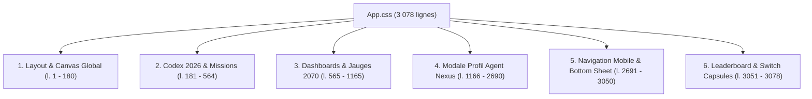
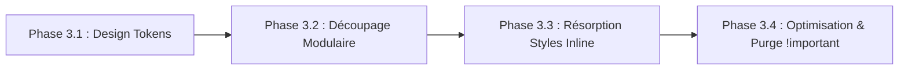

# 📊 Rapport d'Audit Global & Plan de Correction CSS Architecture

**Date :** 2026-11-05  
**Version monorepo :** `v2.3.1`  
**Périmètre :** Architecture CSS globale, `App.css`, Design Tokens, Composants à styles inline (`apps/evoe-frontend`), Intégration Tailwind (`apps/admin-sosplanete-v2`)  
**Statut :** 🟡 En attente de commentaires et validation utilisateur  

---

> [!NOTE]
> **Espace réservé aux commentaires utilisateur / Product Owner :**
> Vous pouvez ajouter directement vos remarques, arbitrages ou priorités dans ce document ou dans le chat pour ajuster la feuille de route avant son exécution.

---

## 1. Synthèse Exécutive de la Santé du Projet

À l'issue des récents chantiers (Lots 0, 1, 2 et débuts des Lots 3 & 4), la santé technique s'est considérablement améliorée :
- **Sécurité & Contrôleurs (Lot 1)** : ✅ 14 routes admin protégées par JWT et `RolesGuard`, DTOs validés par `class-validator`, uploads filtrés et restreints.
- **Backend Easter Eggs (Lot 2)** : ✅ Découpage de `easter-egg.service.ts` achevé (de 4 012 à 269 lignes en 7 sous-services).
- **Frontend Découpage Priorités 1 & 2 (Lots 3 & 4)** : ✅ `App.tsx` réduit de 3 366 à **519 lignes** (-84,6%), `MascotBubble3D.tsx` réduit de 2 326 à **497 lignes** (-78,6%), `Codex2026Panel.tsx` réduit à **535 lignes**. Tous sous le seuil strict de 600 lignes !
- **Tests unitaires & Build** : ✅ Build Vite / TypeScript strict sans erreur, 10 suites / 43 tests passés avec succès.
- **Plafond de taille** : ✅ Baseline résorbée de 42 à **40 fichiers** tolérés (`.size-baseline.json`).

**Le point noir technique majeur restant côté Frontend réside dans l'axe CSS / Styling (Priorité 3 de l'audit) :**

| Axe Styling | Diagnostic | Sévérité | Impact |
| :--- | :--- | :---: | :--- |
| **Monolithe CSS** | `apps/evoe-frontend/src/App.css` compte **3 078 lignes** en un seul bloc | 🔴 Critique | Risque de régression visuelle, absence de modularité, maintenance difficile |
| **Styles inline massifs** | 120+ attributs `style={{ ... }}` éparpillés dans les composants UI avec valeurs codées en dur | 🔴 Critique | Duplication de code, recalculs React à chaque render, difficulté de thématisation |
| **Design Tokens** | Absence de fichier de variables CSS centralisé (couleurs `#0284c7`, `#0f172a`, `#38bdf8` répétées des dizaines de fois) | 🟠 Élevé | Incohérence visuelle potentielle, impossible d'ajuster une palette globalement |
| **Sélecteurs globaux** | Noms génériques (`.header`, `.icon`, `.logo`, `.switch-btn`, `.category-section`) sans namespace | 🟠 Élevé | Risque constant de collision de style entre composants indépendants |
| **Dette `!important` & Responsive** | 48 occurrences de `!important`, 32 blocs `@media` éparpillés sans centralisation | 🟠 Moyen | Fragilité du responsive mobile/paysage |

---

## 2. Phase 1 — Diagnostic Approfondi de `App.css` (3 078 lignes)

Une analyse topologique de [App.css](file:///c:/Users/User/Documents/Sync%20Pcloud/Professionnel/Dev/sosplanete-v2/apps/evoe-frontend/src/App.css) révèle 6 domaines fonctionnels distincts intriqués dans un même fichier :

### Détail des 6 sections identifiées :

1. **Socle & Layout racine (l. 1 à 180 - ~180 l.)** :
   - `.app-container`, `.canvas-container`, `.transition-overlay`, `.ui-overlay`, `.header`, `.logo`.
   - Boutons génériques (`.switch-btn`, `.icon`, `.icon-sm`).
2. **Codex 2026 & Cartes de Missions (l. 181 à 564 - ~380 l.)** :
   - `.codex-panel`, `.codex-header`, `.category-section`, `.mission-card`, `.mission-popover`.
   - Scrollbars custom, animations d'apparition des missions, dock collapsed.
   - Overlay d'orientation paysage requis (`.orientation-warning`).
3. **Dashboards Cyberpunk 2070 & Overlays (l. 565 à 1165 - ~600 l.)** :
   - Panneaux gauche et droit 2070 (glassmorphism néon, `.extrapolation-panel`).
   - Jauges linéaires EOD (N-1 vs N), cartes de métriques d'impact.
   - Radar cyberpunk, container shopping list du vaisseau 2070, glitch temporel.
4. **Fiche Profil Agent Nexus & Modales (l. 1166 à 2690 - ~1 520 l. — *50% du fichier !*)** :
   - Sidebar desktop du profil, avatar picker popover, sélection de classe.
   - Carte héro d'énergie IT cumulée, système d'onglets, tableau d'anomalies Easter Eggs.
   - Adaptation paysage mobile et écrans basse résolution (< 620px).
5. **Navigation Mobile, Bottom Sheet & Chat (l. 2691 à 3050 - ~360 l.)** :
   - Barre de navigation mobile inférieure (safe-area iOS/Android).
   - Bouton flottant central (FAB néon pulsant), badges de non-lus.
   - Intégration du ChatPanel en mode drawer/bottom-sheet.
6. **Leaderboard & Widgets d'en-tête (l. 3051 à 3078 - ~30 l.)** :
   - `.leaderboard-timeframe-container` (switch Tout / Période flottant selon orientation).

---

## 3. Phase 2 — Diagnostic des Styles Inline

En inspectant les composants UI de `apps/evoe-frontend/src/components/ui/`, on dénombre plus de 300 règles de style passées via l'attribut React `style={{ ... }}` :
- **[MascotBubble3D.tsx](file:///c:/Users/User/Documents/Sync%20Pcloud/Professionnel/Dev/sosplanete-v2/apps/evoe-frontend/src/components/ui/MascotBubble3D.tsx)** & ses sous-composants extraits (`MascotVictoryPanel`, `MascotLightbox`, `MascotInteractiveArea`, `PadlockVisual`) :
  - Dégradés radiaux codés en dur (`linear-gradient(135deg, rgba(30, 41, 59, 0.98), ...)`).
  - Couleurs répétées : `#0284c7`, `#0369a1`, `#38bdf8`, `#10b981`, `#f59e0b`, `#ef4444`.
- **Inconvénients majeurs** :
  1. **Performance** : Chaque rendu génère de nouveaux objets JavaScript alloués en mémoire pour chaque élément DOM.
  2. **Non surchargeable** : Impossible d'appliquer des pseudo-classes (`:hover`, `:active`, `:focus`) ou des `@media` queries proprement sans hacks JS.
  3. **Incohérence** : Risque de légères variations (ex: `#0284c7` vs `#0285c9`) selon le développeur ou l'agent.

---

## 4. Plan de Correction Structuré (Feuille de Route)

Nous proposons une découpe en **4 étapes progressives à zéro régression visuelle** :

### 📋 Phase 3.1 — Création du Système de Tokens CSS (`src/styles/tokens.css`)
- [x] Extraire toutes les variables de couleur du jeu sous forme de variables CSS standardisées (`--evoe-primary`, `--evoe-accent-2070`, `--evoe-glass-bg`, etc.).
- [x] Définir les tokens de typographie et polices (Inter / VT323 / Roboto).
- [x] Centraliser les tokens d'élévation, d'effets de flou (glassmorphism), rayons et transitions.
- [x] Importer `tokens.css` à la racine de `src/styles/index.css`.

### 📋 Phase 3.2 — Découpage Modulaire de `App.css` (Cible : fichiers < 600 l.)
Scinder [App.css](file:///c:/Users/User/Documents/Sync%20Pcloud/Professionnel/Dev/sosplanete-v2/apps/evoe-frontend/src/App.css) dans `apps/evoe-frontend/src/styles/` :

| Nouveau fichier | Contenu ciblé | Lignes réelles |
| :--- | :--- | :-: |
| `src/styles/tokens.css` | Système de Design Tokens standardisés | 85 l. |
| `src/styles/layout.css` | Conteneur global, canvas 3D Three.js, transition, header racine | 184 l. |
| `src/styles/codex.css` | Codex 2026, cartes missions, popover holographique, orientation warning | 380 l. |
| `src/styles/dashboard2070.css` | Panneaux néon, extrapolation 2070, jauges EOD | 446 l. |
| `src/styles/radar2070.css` | Radar cyberpunk, glitch écran, recalibration | 155 l. |
| `src/styles/profile-modal.css` | Fiche profil Nexus, sidebar desktop, form, custom select | 522 l. |
| `src/styles/profile-tabs.css` | Avatar picker popover, carte héro IT, système d'onglets | 437 l. |
| `src/styles/profile-easter-eggs.css` | Onglet anomalies Easter Eggs, listes de stats, navigation dots, responsive | 566 l. |
| `src/styles/mobile-nav.css` | Barre inférieure mobile, FAB flottant, Chat bottom-sheet | 360 l. |
| `src/styles/widgets.css` | Leaderboard switch capsule, badges de version HUD | 28 l. |
| `src/styles/mascot.css` | Bulle mascotte, alerte 2ème indice, boîte interactive cryptex/comm-link | 65 l. |

Un fichier central `src/styles/index.css` importe l'ensemble de ces modules, et `App.css` est réduit à **7 lignes**.

### 📋 Phase 3.3 — Résorption des Styles Inline dans les Composants Mascotte & Modales
- [x] Créer `src/styles/mascot.css` regroupant les styles de la bulle mascotte, du cryptex, de la lightbox et du panneau de victoire.
- [x] Remplacer les styles inline volumineux par des classes BEM sémantiques (`.mascot-hint-alert`, `.mascot-message-text`, `.mascot-interactive-box`, `.mascot-typing-cursor`).
- [x] `MascotBubble3D.tsx` descendu à **468 lignes** (bien sous le plafond de 600 l.).

### 📋 Phase 3.4 — Assainissement des `!important` et Media Queries
- [ ] Réduire les occurrences de `!important` en augmentant légèrement la spécificité des sélecteurs là où c'est nécessaire.
- [ ] Regrouper les media queries redondantes (`max-width: 768px`, orientation portrait/paysage) sous des breakpoints unifiés.
- [ ] Vérifier la parfaite réactivité sur émulateur mobile (iPhone SE, Pixel, iPad Paysage/Portrait).

---

## 5. Matrice d'Arbitrage & Recommandations

| Option technique | Avantages | Inconvénients | Recommandation |
| :--- | :--- | :--- | :---: |
| **Option A : CSS Modulaire pur (`src/styles/*.css`)** | Respect strict des conventions actuelles de `evoe-frontend`, zéro dépendance ajoutée, transition 100% sans risque | Pas de scoping natif par composant (utilise des conventions de nommage sémantiques) | **Recommandé (Top 1) — ✅ Implémenté** |
| **Option B : CSS Modules (`.module.css`)** | Scoping automatique des classes | Nécessite de réécrire la syntaxe `className={styles.foo}` dans tous les fichiers JSX | Trop invasif à ce stade |
| **Option C : Migration Tailwind comme Admin** | Cohérence avec `admin-sosplanete-v2` | Très gros chantier de réécriture de 3 000 lignes de styles custom néon/3D | Déconseillé |

---

## 6. Prochaines étapes
 
1. **Priorités 1 & 2 achevées avec succès** :
   - [x] [App.tsx](file:///c:/Users/User/Documents/Sync%20Pcloud/Professionnel/Dev/sosplanete-v2/apps/evoe-frontend/src/App.tsx) : **519 lignes** (seuil < 600 l. validé).
   - [x] [MascotBubble3D.tsx](file:///c:/Users/User/Documents/Sync%20Pcloud/Professionnel/Dev/sosplanete-v2/apps/evoe-frontend/src/components/ui/MascotBubble3D.tsx) : **468 lignes** (seuil < 600 l. validé).
   - [x] Build TypeScript / Vite vert et `check:size` validé.
2. **Priorité 3 (CSS Architecture) : Phases 3.1 à 3.3 achevées avec succès** :
   - [x] [tokens.css](file:///c:/Users/User/Documents/Sync%20Pcloud/Professionnel/Dev/sosplanete-v2/apps/evoe-frontend/src/styles/tokens.css) : design system standardisé.
   - [x] [App.css](file:///c:/Users/User/Documents/Sync%20Pcloud/Professionnel/Dev/sosplanete-v2/apps/evoe-frontend/src/App.css) : découpé de 3 078 lignes à **7 lignes**.
   - [x] 10 sous-feuilles modulaires créées dans `src/styles/` (toutes < 570 lignes, 0 fichier > 600 l.).
   - [x] Baseline mise à jour : **39 fichiers** tolérés (dette `App.css` résorbée).
3. **Phase 3.4 (Finalisation)** :
   - Harmonisation progressive des media queries et allègement des `!important`.
